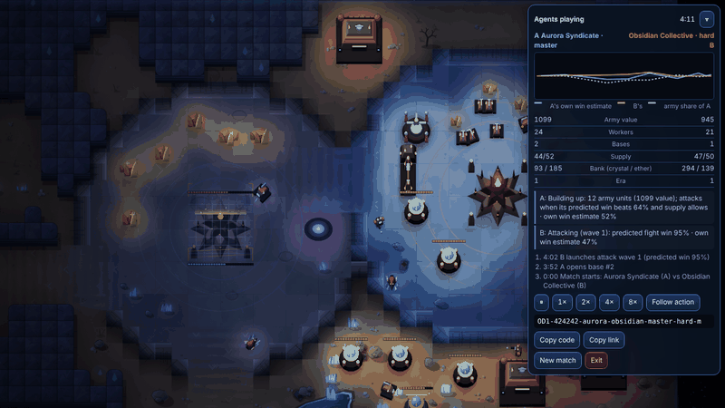
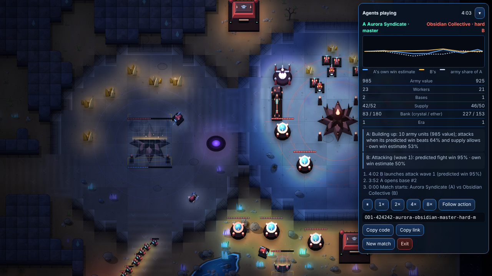
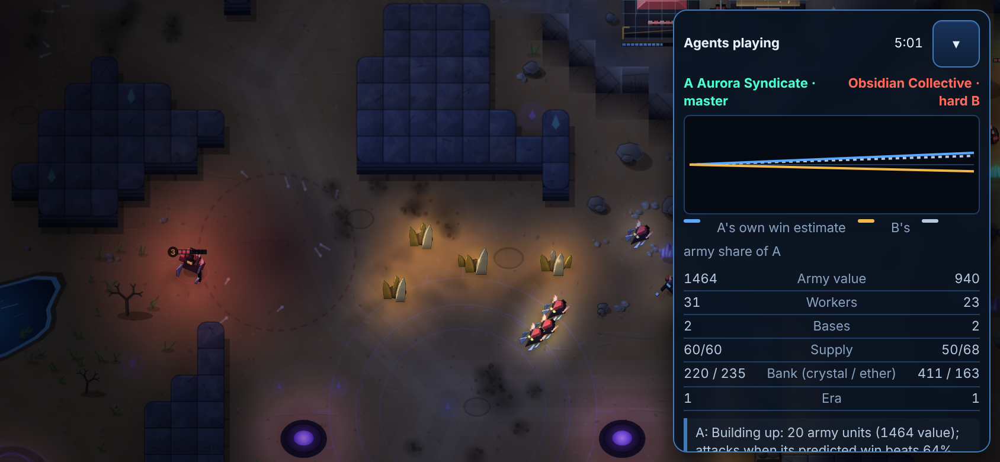

# Orbital Dominion: swarm agents as game design

> **An open-source RTS and research testbed for putting small, inspectable AI agents *into* gameplay: as opponents, as delegates, as teammates and as teachers.** Inspired by StarCraft-style play and by DeepMind's AlphaStar / AlphaGo line of work, scaled down to run in a single HTML file, with no server, no GPU and no language model.

| | |
|---|---|
| **Play** | **https://veo555.github.io/Orbital-Dominion/** (any modern browser, desktop or phone; installable as an app), or open `dist/orbital_dominion_v4.html` locally. Watch a match directly: `https://veo555.github.io/Orbital-Dominion/#watch=OD1-424242-aurora-obsidian-master-hard-m` |
| **Also on** | Hugging Face: [Space](https://huggingface.co/spaces/veo555/orbital-dominion) · [tournament dataset](https://huggingface.co/datasets/veo555/orbital-dominion-tournament) (48 replayable games) |
| **Idea** | agents play against each other, agents play *for* you (swarm / Overseer), agents explain themselves and advise you, humans learn from watching them |
| **Research** | `docs/RESEARCH_VISION.md` (thesis, system, honest scope), `docs/RESEARCH_AGENDA.md` (unrun studies and open problems) |
| **Evidence** | `docs/AI_LEAGUE_RESULTS.md` (league, Elo, ablations), `docs/KNOWN_LIMITATIONS_AND_TEST_RESULTS.md` |
| **Licence** | MIT, contributions welcome: `CONTRIBUTING.md` (name and logo: `TRADEMARKS.md`; cite: `CITATION.cff`) |
| **Try and give feedback** | `docs/launch/TESTER_GUIDE.md`, issue template *Playtest report* |
| **Play it with an AI (MCP)** | [`mcp/README.md`](mcp/README.md): an MCP server so Claude, Cursor or your own client can play or watch matches through tools (fog-honest, replayable, local) |
| **Evaluate it** | [`docs/EVALUATE.md`](docs/EVALUATE.md): 15-minute checklist, `node tools/tournament.js` (agent tournament with intervals and replay codes) |
| **Quant research** | [`research/manager-diligence`](research/manager-diligence) (selection-bias-aware track-record statistics) · [`research/quant-lab`](research/quant-lab) (pricing, VaR/ES backtests, GARCH, overfitting diagnostics; mutation-tested) · [`docs/papers/lucky_manager.md`](docs/papers/lucky_manager.md) |
| **Direction** | `docs/HYBRID_STRATEGY.md` (open core, optional cosmetic-only paid layer, tripwires) |

## Watch the agents play (new in 6.1)

Main menu -> **Watch agents**: two AI agents play a full match while a panel shows **each agent's own win estimate over time, what it is doing and why, and the key moments**. Every match has a short **replay code**, and a page link plus `#watch=<code>` opens that exact match, so you can share a game, replay it, or compare tiers and factions on the same map. Details: [`docs/SPECTATE_AND_REPLAY.md`](docs/SPECTATE_AND_REPLAY.md).



<p> </p>

Example match: `OD1-424242-aurora-obsidian-master-hard-m`.

**Why it is interesting.** The same deterministic simulator runs a full match in your browser *and* much faster than real time headless (not benchmarked here), so one codebase is simultaneously a game you can play, a spectator sport (the menu is agents playing each other), and a benchmark for multi-agent methods (league self-play with CMA-ES and PFSP, Bradley-Terry ratings, an AlphaGo-style planner shipped off after a documented null result).

**What it is not.** No language model anywhere (the Overseer's text box is a rule-based grammar); not a reproduction of AlphaStar; no human study has been run yet, so "makes games more interesting" and "humans learn from agents" are *hypotheses this project exists to test*, not results. See the research vision for the exact status of each claim.

---

# Orbital Dominion v6 — project handoff package

A real-time strategy game (three factions, three eras, fog of war, heroes, a Caesar-style colony economy, a
Patrizier-style market) with a **swarm-agent layer**: every unit can be an autonomous agent with a role, a wallet and
XP; a master AI ("the Overseer") directs the colony; a labour marketplace lets you hire freelancers and take jobs on
five billing cadences (minute / hour / day / month / per task).

It ships three ways from one source tree (`python3 build.py`): a **single self-contained HTML file**
(`dist/orbital_dominion_v4.html`, ≈ 1.2 MB since 5.0 (2.0 MB with the 3.x films), no external requests, no libraries) to download and share; an **installable,
offline-capable web app** (`dist/pwa/`); and a **store build** (`dist/store/`) for Capacitor wrappers. See `docs/DEPLOY.md`.

## For evaluators: how to look at this project in 10 minutes

**What it is.** A canvas real-time-strategy game in one self-contained HTML file (no libraries, no network requests), built from ~90 plain JavaScript modules by `python3 build.py`. Three factions, fog of war, a rule-based opponent AI trained by self-play league tuning (no LLM), walls/bunkers/abilities (v6), a campaign, PWA install, optional cosmetic-only payments (off by default).

**Play it.** Open `dist/orbital_dominion_v4.html` in a browser (nothing to install), or serve `dist/pwa/` over http(s) to install it on a phone (`docs/INSTALL_IPHONE.md`).

**Build and test.**
```
python3 build.py                 # -> dist/orbital_dominion_v4.html, dist/pwa/, dist/store/
node tests/sim/smoke.js          # headless simulation checks (seconds)
node tests/sim/fortify.js        # walls / gates / bunkers / mines (~1 min)
node tests/sim/arsenal.js        # units / abilities (~1 min; add --mutants to prove the tests can fail)
node tools/tournament.js --quick  # agent tournament: scores with intervals, replay code per game
node tests/sim/replay.js         # replay determinism: same code, same match (add --mutants)
bash tests/run_all.sh            # full gate incl. Playwright browser tests (~30 min; needs Playwright 1.56 + Chromium)
```

**Where to read the code.** `docs/ARCHITECTURE.md` (module map: numeric prefixes, which modules are headless-testable), then `src/js/20_sim.js` (rules), `41_ai_*`/`42_ai_agent.js` (opponent), `56_mesh3d.js` + `57_recipes.js` (bake-time 3D sprites), `31_defense.js`/`33_abilities.js` (v6). Engineering rules and known traps are in `CLAUDE.md`; design intent in `docs/DESIGN_FORTIFY.md`, `docs/DESIGN_ARSENAL.md`, `docs/AI_DESIGN.md`, `docs/RESEARCH_ALPHASTAR_AND_SWARMS.md`.

**Properties worth checking.** Fixed-timestep deterministic simulation (same seed, same result; tested); tests are mutation-proofed (a test must fail when the code is broken, `--mutants`); zero network requests asserted in the browser gate; the build is generated, so review `src/`, not `dist/`.

**Honest limits.** It has never been run on a real phone; no person has listened to the audio; the full gate passed on the author's cloud container only; the AlphaGo-style planner ships off because it showed no measured gain; balance of the v6 units rests on a duel simulator and small matches, not a 24-seed A/B; the Master and Hard AI tiers are not statistically separated. Details: `docs/KNOWN_LIMITATIONS_AND_TEST_RESULTS.md`.

**Licence.** MIT, see `LICENSE`.

> **Read first:** `docs/KNOWN_LIMITATIONS_AND_TEST_RESULTS.md` (what has and has not been verified — **no real phone has run
> this yet**) and `docs/STORE_RELEASE_ROADMAP.md` (what stands between this and the stores).

## 0000a. What changed in 6.0 (Oct 2026): grounded sprites, FORTIFY, ARSENAL

* **Grounding fix** (`54_light.js`): every unit, building and crystal now has a contact shadow at its base, and the cast shadow starts at the base instead of 0.6 shadow-lengths away, which is what made 5.0 look as if everything floated. Checked by screenshots (desktop/phone), not by a numeric test.
* **FORTIFY** (below, `docs/DESIGN_FORTIFY.md`): wall lines, gates, bunkers, towers, mines, detection, dropships, map rocks.
* **ARSENAL** (below, `docs/DESIGN_ARSENAL.md`): 11 units, abilities, tech tiers, damage types.
* Both tracks are **locked in campaign missions** (campaign behaves as 5.0) and available in skirmish. The two tracks share one detection helper (`detectorsCover` in `33_abilities.js`; `isDetectedBy` in `31_defense.js` wraps it).
* Evidence: full `bash tests/run_all.sh` on the merged tree (see `docs/KNOWN_LIMITATIONS_AND_TEST_RESULTS.md` §v6). Honest limits: no balance A/B of the new units over >=24 seeds beyond what `fortify_ab.js` / the duel simulator report; nothing run on a real phone.

## v6-G1 FORTIFY (Oct 2026): walls, gates, bunkers, detection, map features
Haulers get a **Defence** page (D): Walls drawn as a line (drag, or two taps on touch; built segment by segment), team-aware **Gates** (auto / open / closed), **Bunkers** (4 infantry, +1 tile range, salvage), **Cannon Tower** (ground), **Anti-Air Battery** (air), **Sensor Tower** (radar blips), **Repair Battery**, cloaked **Proximity Mines**; Hubs gain a **Scanner Sweep** and a one-way **Fortress** upgrade; the Airfield builds a **Dropship** (8-slot transport). Walled-in targets are breached (no unit freezes), you cannot wall yourself in, skirmish maps can get neutral rock formations and a rich crystal field, the skirmish AI builds Bunkers / Repair Batteries under pressure and (Hard/Master) walls its ramp against rushes. Campaign missions lock all of it and are unchanged. Design, numbers and test evidence: `docs/DESIGN_FORTIFY.md`; tests `tests/sim/fortify.js` (`--mutants`), `tests/e2e/e2e_fortify.py`.
## 0000. v6 ARSENAL (track G2): abilities, new units, tiers, damage types

11 new combat units (Lancer, Flak Trooper, Interceptor, Watcher, Dreadnought for everyone; Sunderer + Disruptor for Meridian, Jackal + Mauler for Obsidian, Marksman + Phantom for Aurora), a generic unit-ability framework (`src/js/33_abilities.js`: cooldown, energy, autocast, targeting, queueable; Overdrive, Siege Mode, Cloak, Pounce, Sprint, Overcharge, EMP, Snipe, Burrow, Orbital Lance, Pulse Scan, Barrage), two tech structures (Research Lab, Siege Works), tiered upgrades (Stims I-III, Barrier Field I-III, Siege Optics, Cloak Cells, Energy Cells), damage types x armor classes, shields. Campaign missions keep the v5 roster (locked). Design, numbers, matrices and evidence: `docs/DESIGN_ARSENAL.md`; gates: `node tests/sim/arsenal.js [--mutants]`, `tests/sim/duel.js`, `tests/sim/arsenal_ab.js`, `tests/sim/arsenal_cpu.js`, `python3 tests/e2e/e2e_arsenal.py`, `tests/audio/arsenal_gate.py`.

## 000. What changed in 5.0 (12 Oct 2026): 3D-style sprites, console HUD, no speech, lean + robust file

| Area | What is in the build | Evidence (Chromium headless / Node; nothing heard, no real phone) | Not verified / honest limits |
|---|---|---|---|
| **3D look** | Units and buildings are **pre-rendered 3D**: a small bake-time software rasteriser (`56_mesh3d.js`) renders procedural meshes (recipes in `57_recipes.js`) with key light, ambient occlusion and a glowing team-colour layer into per-facing sprites, cached lazily; tilted camera, visible roofs and fronts, depth-sorted draw order, cliff faces and shaded terrain, boulders and crystals, sun shadows, bloom on the top tier. `docs/GRAPHICS_V5.md`, before/after in `docs/img/v5/` | `e2e_visual.py` (pixel assertions incl. draw order, with mutation proofs), terrain/touch/platform gates | no GPU, no iOS WebKit, no real phone frame times; the look is "StarCraft II-inspired", all art is original and procedural |
| **Console HUD** | chamfered metal panels, glowing accent line, glassy command buttons, segmented health bars (CSS only, geometry unchanged) | e2e touch / campaign layouts at 5 viewports, screenshots looked at | |
| **No speech** | the speech engine, announcer, barks, voice-pack pipeline and ElevenLabs tooling are **removed**; radio lines and dispatches are silent text; music (25 cues) and all sound effects stay (creature growls kept, human-vowel layers removed) | audio engine / wiring / Sound Lab / mix gates, `units_gate` | nothing heard by a person; `world_gate.py` known failing; one engine check (orphan nodes) is regression-only |
| **Lean + robust** | safe build-time minifier (`tools/minify.js`, no renaming): standalone **2.03 MB (v3.3) to 1.17 MB, 372 KB gzipped**; error boundaries (frame loop in guarded stages, recovery dialog after repeated faults, global handlers), audio can never break gameplay, storage faults tolerated, service-worker stale-build repair, watchdog, camera/viewport repair, each with a fault-injection test and mutation proof | `tests/minify/*`, `tests/sim/minify_determinism.js` (sim hashes identical minified vs readable), `e2e_robust_core/audio/storage`, `e2e_pwa_stale` | 1.0 MB target missed (icons and tables); offline fallback page untested |
| **AI** | AlphaGo-family ideas added on top of the 4.0 league AI: a PUCT macro-planner on a calibrated abstract model with determinised worlds from the belief grid, expert iteration (policy head fitted to search visit counts), and a computed "win chance a % to b %" line on Overseer proposals. **The planner ships switched off**: measured planner on vs off 50.0 % [36, 64] over 48 mirrored games, no gain, +10.7 % CPU. Tier ladder as in 4.0 (Master vs Hard not above 50 %). **No language model anywhere**: the opponent and the Overseer are rule-based + search + tiny learned value models. `docs/AI_DESIGN.md`, `docs/AI_LEAGUE_RESULTS.md` | `tests/sim/ai_*.js` incl. PUCT mutants and a no-peek mutant, determinism, save round trip, `off.js` identical to v2 | nobody has played against it; bot-vs-bot Elo is not human Elo; the abstract model does not predict battles; campaign missions still use the v3 AI (the new AI fails m05/m06/m08 balance) |
| **Publishing** | installable PWA (`dist/pwa`), GitHub Pages workflow, iPhone install guide `docs/INSTALL_IPHONE.md` | served from a `/claude/` sub-path: service worker, manifest, match start, offline reload all OK | Pages must be enabled by the repository owner (private repos need a paid plan); never run on a real iPhone |

---

## 00. What changed in 4.0 (9 Oct 2026): no video, new graphics, new AI, new audio chain, Material 3 shell

| Area | What is in the build | Evidence (Chromium headless / Node, software raster; nothing heard, nothing on a real phone) | Not verified |
|---|---|---|---|
| **No video** | All films removed; the story is 32 text dispatches + Archive (section 0 below). Build 2.03 MB to about 1.4 MB | `e2e_campaign.py`, story validator (0 errors, 59 mutations caught) | readability of dispatch cards on real phones |
| **Graphics** | Light buffer with a real day/night ramp, sun-direction shadows, rim/edge occlusion on sprites, damage soot/cracks, construction scaffolds, particles (trails, sparks, smoke, embers), terrain macro-variation, softer fog edge, bloom on the *ultra* tier only, redesigned bars/rings/minimap. Details, maths, tier table, perf: `docs/GRAPHICS_V4.md`; before/after in `docs/img/v4/` | `tests/e2e/e2e_visual.py` (pixel assertions with mutation proofs); perf, software raster: high tier +26 to +29 % frame time, battery about +8 to 10 %, game start 100-300 ms slower | any GPU, WebKit/iOS (`shadowBlur`, `multiply`, `lighter` blends), real phone frame times |
| **Google design** | Material 3 layer: colour roles mapped onto the tokens (faction accent = primary), shape scale, state layers, ripple, dialog motion, window size classes, 48 px targets where room, regrouped pause menu; People+AI guidance for the Overseer. `docs/DESIGN_SYSTEM.md` section 9 | design check, `e2e_campaign.py` layouts at 5 viewports, screenshots looked at (desktop, iPhone landscape, Pixel portrait) | a real Android device; no adaptive navigation rail (nothing to navigate) |
| **AI** | A new fog-honest opponent for skirmish and the menu demo (campaign missions keep the v3 AI they were balanced against): Bayesian belief grid + stigmergic scouting, Lanchester-blend fight predictor, boids formations, Ideal-Free-Distribution workers, APM cap and reaction delay per tier, a learned value function V(s), parameters tuned by a headless **league** (CMA-ES, PFSP, main + exploiters, Bradley-Terry Elo). Four tiers, income x1.0 on all. `docs/AI_DESIGN.md`, `docs/AI_LEAGUE_RESULTS.md`, research note `docs/RESEARCH_ALPHASTAR_AND_SWARMS.md` | 24 mirrored games per pairing with Wilson CIs: Master beats the old Hard AI **at equal income** 85 % [66, 95] and loses to it with its +25 % income cheat (45 %); Normal 77 % and Easy 98 % vs their old counterparts; adjacent new tiers Master>Hard 56 % [37, 74], Hard>Normal 65 % [45, 81], Normal>Easy 73 % [53, 87] (**not significant individually**); value function AUC 0.825, Brier 0.106; fight predictor accuracy about 90-95 %; CPU +6 % of tick time; no-peek, determinism, APM-bound and save round-trip tests | **no human has played against it**; bot-vs-bot Elo is not human Elo; the league ran 118 of 150 planned minutes and plateaued after about 15 generations; Master is not clearly separated from Hard; Aurora is weak against the old Hard AI |
| **Audio** | New master chain (glue compressor, trim, limiter, soft clip), BS.1770 loudness meter in the tests, voice-over ducking, distance low-pass and reverb send for positioned voices, equalised music cue loudness and intensity layers; **optional offline ElevenLabs voice-pack pipeline** (`tools/voicepack/`, loader default off, no network). `docs/AUDIO_V4.md` | offline-renderer measurements (battle -15.1 LUFS-I / -2.2 dBTP, calm -24.1 LUFS-I, voice line +4 LU over a dense fight), engine/wiring/Sound Lab/voice-pack tests with mutations | **nothing was heard by a person**; `world_gate.py` and `voice_gate.py --quick` still have failing checks (listed in `docs/AUDIO_V4.md`); ElevenLabs was never called: its free plan has no commercial licence, about 10 000 credits/month and the script needs about 20 000 characters |
| **Process** | `docs/MASTER_PROMPT.md` is a prompt to rebuild the whole project; `tests/run_all.sh` now includes every gate above (about 20 minutes) | `bash tests/run_all.sh` | |

---

## 0. 4.0: videos removed (T1)

The procedural real-time films (the cinematic engine, its backgrounds, props and effects: `64_cine_bg_*`, `64_cine_props`, `65_cine_fx`, `66_cine`, about 0.7 MB of the build) are gone. The story survives as **text dispatches**
(`STORY.dispatch`, 32 of them, 278 spoken lines plus datelines, none dropped): a modal text card with speaker portrait chips, Continue / Skip all, shown as prologue, briefings, debriefs, interludes, defeats, ending and credits, and re-readable from the new **Archive**
(replaces the Extras gallery). The `cine` mission action is now `dispatch` (still blocking). The character portrait painter stays (`64_portrait_core.js`, `64_portraits.js`). Spec: `docs/DISPATCH_SPEC.md`. Save format unchanged.
Build size 2,026,361 to 1,322,454 bytes for `dist/orbital_dominion_v4.html`. The 3.x sections below describe what was true then; their film rows are historical.

---

## 0a. What changed in 3.3 (8 Oct 2026): first measurements, save/resume, field manual

| Area | Change | Evidence (headless Chromium / Node on Linux; nothing heard, no real phone) |
|---|---|---|
| **Resume** | The running match (skirmish or campaign mission) is autosaved every 30 s, when the app goes to the background and when you pause; the main menu then offers **Continue**. Erased when the match ends. New sim-side module `46_save.js` (reference-preserving snapshot of the whole game state), UI in `78_resume.js` | `node tests/sim/save.js`: snapshot, restore, N ticks gives the same state hash as without the round trip (skirmish, AI-vs-AI, three campaign missions), with three controls that must fail when the snapshot is tampered · `tests/e2e/e2e_resume.py` (reload, Continue, same time/units/buildings, terrain rebuilt, game over erases the slot, corrupt slot rejected) |
| **Field manual** | Mission 1 shows the next two undone basics (train Haulers, build a Generator, build a Garrison) under its objectives (Settings > Hints turns it off; hidden in the compact phone layout, where the radio strip carries the teaching) | `tests/e2e/e2e_campaign.py` still passes |
| **Balance** | All nine missions were played 24 times each by the built-in AI as a stand-in player; the four missions it cannot judge got walkthrough bots. Three data fixes came out of it (m06 Meridian turret ring 4 to 3, m09 win now needs the Foci destroyed, two branch triggers in m04 marked optional) | `tests/sim/campaign_balance.js --full`, `tests/sim/campaign_walkthrough.js`; table in `docs/KNOWN_LIMITATIONS_AND_TEST_RESULTS.md` section 1.3 |
| **Gate** | `tests/run_all.sh` now also runs the save, campaign, resume, cinematic and portrait checks. A pre-existing flaky assertion (perks cosmetic) was made deterministic by pinning `Math.random` | `bash tests/run_all.sh` |

---

## 0. What changed in 3.2 (8 Oct 2026): story, campaign, cinematics, sound

The game now has a single-player campaign, *The Lantern Tithe*: nine missions in three acts, films between them, and a
new sound engine. Everything here was produced by automated authoring passes and checked with the commands below. Read
the last column before relying on any claim.

| Area | What is in the build | Checked in headless Chromium / Node | Not checked |
|---|---|---|---|
| **Story** | 9 missions; 16 characters (8 good, 3 evil, the rest grey or narrator); 32 films (intro ≈ 81 s, 9 briefings, 9 debriefs, 8 interludes, ending ≈ 128 s, credits, 3 defeat scenes; ≈ 20 min of film, 391 spoken lines); 113 radio lines; hero and worker barks | `node tools/validate_story.js`: 0 errors, 0 warnings. `node tests/story/validate_selftest.js`: 56 deliberate corruptions, all caught | Whether the writing lands with players; no editor has read it |
| **Campaign** | Chapter select, briefings, radio strip, objectives and stars, debriefs, progress saved in the browser, cinematics gallery | `node tests/sim/campaign.js`: 394 checks pass (every condition and action op, restrictions, determinism, swarm-off inertness, save helpers) | Difficulty for humans; the balance playtests (`tools/mission_sim.js`, `tests/sim/campaign_balance.js`) exist but were not run |
| **Cinematics** | Real-time procedural films: 12 backgrounds, 12 prop kinds, 19 effects, portraits drawn from each character's look data, subtitles, skip, WebM export where the browser can record | A headless browser draws every effect kind; the crowd, banner and unit props were spot-checked; the intro plays for 2 s with no painter errors | Real GPUs and phones; WebM export on iOS; subtitle legibility on phones |
| **Sound** | Synthesized engine; 478 voices (unit types × factions, workers and fighters, hero skills, buildings, UI, cinematic sfx); 25 music cues including the three faction themes; leitmotifs; synthesized character voices, plus device speech where available; Sound Lab under Settings | A headless browser starts a real match (creating the audio context), plays all 25 music cues, and fires unit, building, hero, cinematic sounds and speech with no page errors | **Nobody has listened to it.** Loudness, balance and taste are not measured by ear |

Commands: `python3 build.py` (rebuild every variant), `node tools/validate_story.js` (story data), `node tests/story/validate_selftest.js`
(the validator's own mutation test), `node tests/sim/campaign.js` (campaign runtime), `node tests/sim/smoke.js` (simulation),
(3.2 also shipped `tools/cine_contact.py`, removed in 4.0.)

---

## 0b. What changed in 3.1 (6 Oct 2026)

| Area | Change | Evidence |
|---|---|---|
| **Phones and tablets** | three responsive layouts (desktop / landscape phone / portrait phone), measured HUD geometry instead of the fixed 44/198 px constants, Pointer-Events touch layer (pan with inertia, tap select / command, hold-to-box-select, pinch zoom, minimap, long-press help sheets, placement confirm bar, touch dock), iOS zoom blocking, safe-area insets. Map share of an 844 × 390 phone screen: 38 % → 62 %. | `tests/e2e/e2e_touch.py` (real multi-touch, iPhone + Pixel profiles) · `docs/TOUCH_SPEC.md` |
| **Design** | documented colour tokens, hover only where hover exists, focus ring, reduce-motion, colour-blind-safe team palette (blue vs orange), menu reflow, touch wording | `tools/design_check.py` (WCAG contrast + CIEDE2000 under protan/deutan/tritan) · `docs/DESIGN_SYSTEM.md` |
| **HD graphics** | quality tiers + adaptive scaler, sharp 2×/3× terrain tiles near the camera (1× base unchanged: identical pixel hashes), retina-crisp icons / charts / minimap, resampling quality only where it pays, glow / vignette / dust effects | `tools/perf.py`, seam test (tile join ≤ 12/255 vs a single bake) |
| **App behaviour** | auto-pause and audio suspend when backgrounded, wake-lock, Android Back = pause (installed), fullscreen, install button (Android prompt / iPhone instructions), share | `tests/e2e/e2e_platform.py` |
| **Web app** | manifest, offline-first versioned service worker with an update prompt, icons + logo, `_headers`, CI + Pages workflows | `tests/e2e/e2e_pwa.py` (offline reload and match, Chrome installability verdict, update flow) |
| **Optional payments** | Stripe-hosted checkout (Payment Links or a Worker backend), cosmetic perks only, **off by default**, hidden in store/native builds | `tests/e2e/e2e_support.py` (28 checks) · Worker unit tests (9, mutation-tested) · `docs/MONETIZATION.md` |

New commands: `bash tests/run_all.sh` now runs every gate (≈ 5 min); `python3 tools/shots.py` renders device screenshots; `python3 tools/perf.py` measures render cost;
`python3 tools/design_check.py` verifies the colour tokens; `npm run serve` serves the web app on :8080.

---

## 1. Quick start

```bash
# requirements: Python 3.9+, Node 18+ (tested with Node 22), for browser tests: pip install playwright && playwright install chromium
python3 build.py                 # src/  ->  dist/orbital_dominion_v4.html   (pure concatenation, no dependencies)
open dist/orbital_dominion_v4.html   # or double-click; it runs from file://

bash tests/run_all.sh            # build + simulation smoke (~40 s) + browser smoke (~40 s)
```

Individual gates and tools:

| Command | What it does |
|---|---|
| `node tests/sim/smoke.js` | Headless regression gate (~1 min): 6 seeds × 3 factions with Autopilot, invariants (finite resources, supply ≤ cap, no NaN wallets), **bit-exact determinism**, **swarm-off ≡ v2 baseline** (3 seeds), natural-language parser checks |
| `python3 tests/e2e/e2e_smoke.py` | Real-browser gate (Playwright/Chromium): boots with zero console errors and **zero network requests**, Autopilot plays 150 s, Swarm panel/tabs/command box, hotkey isolation, pause semantics, top-bar fit at 4 widths |
| `python3 tests/e2e/mobile_probe.py` | *Informational*: phone/tablet viewports with touch; writes screenshots to `tests/out/` (shows the current mobile gaps) |
| `node tests/sim/match2.js 21,22,23 18 normal` | Autopilot vs. built-in AI, seeds × game-minutes × difficulty (set `RS=7` for a seeded `Math.random`, `SRC=<dir>` to test another source tree) |
| `node tests/sim/eco.js 1,2,3,4,5,6 300` | Deterministic early-game economy metrics (supply-blocked seconds, floating crystals, army size) |
| `node tests/sim/timeline.js 7 10` | Per-30-s timeline of one match (resources, supply, roles, enemy) + Overseer log tail |
| `RS=5 node tests/sim/off.js ../../src/js 1,2,3 300` (and `RS=5 LIB=./simlibv2.js … ../../baseline/v2/src/js`) | Swarm-OFF equivalence printout (run from `tests/sim/`; **always set `RS`** or `Math.random` noise hides the comparison). The same check runs as an assertion in `smoke.js` |
| `tools/ab.sh <srcA> <srcB>` | Parallel A/B balance comparison of two source trees over 24 seeds |
| `tools/diag/*.js` | ~30 single-purpose diagnostic scripts used while tuning (kept as worked examples of how to probe the sim) |
| `tests/e2e/e2e_*.py` | The exploratory Playwright flows used during development (print, don't assert) — useful as recipes |

## 2. Folder map

```
README.md, CLAUDE.md          this file · briefing for an AI coding agent working in the repo
build.py                      concatenates src/js/*.js (alphabetical) + style.css + body.html into dist/...html
package.json                  npm scripts (no runtime dependencies)
src/
  body.html                   HUD / menu / panel markup (ids referenced from JS)
  style.css                   all styling (responsive breakpoints at 1180 / 900 / 760 px)
  js/                         the game, 18 modules, numeric prefix = load order (see docs/ARCHITECTURE.md)
dist/orbital_dominion_v4.html the built single-file game (identical to what build.py produces)
tests/
  sim/                        headless Node harness (vm sandbox) + smoke / match / eco / equivalence scripts
  e2e/                        Playwright scripts (e2e_smoke.py is the gate; the rest are exploratory)
  run_all.sh                  build + both gates
tools/                        A/B scripts, diag/ probes
baseline/v2/                  previous version (source + build) — reference for swarm-off equivalence
baseline/v1/                  first version, reference only
screenshots/                  reference screenshots of the v3 UI and of the *current* mobile layout problems
docs/                         all handoff documents (below)
```

## 3. Documents

| File | Purpose |
|---|---|
| `docs/STORE_RELEASE_ROADMAP.md` | Phased plan from this web build to App Store / Google Play, with the **verified (Oct 2026)** store requirements, wrapper decision, effort ordering and release gates |
| `docs/ARCHITECTURE.md` | Module map, simulation loop, swarm/Overseer/economy design, math, determinism, test hooks, extension recipes |
| `docs/GAME_DESIGN.md` | Factions, eras, units, buildings, systems — the design reference (also source material for store listings and a tutorial) |
| `docs/KNOWN_LIMITATIONS_AND_TEST_RESULTS.md` | Honest status: measured results, what was *not* tested, known issues, technical debt |
| `docs/QA_CHECKLIST.md` | Release QA matrix: devices, functional, performance, lifecycle, audio, store compliance |
| `docs/BACKLOG.md` | Prioritised work items (P0/P1/P2) with acceptance criteria |
| `docs/KICKOFF_PROMPT.md` | A ready-to-paste first prompt for the coding environment |
| `docs/DESIGN_SYSTEM.md` | Colour tokens with measured contrast and colour-blind safety, layouts, accessibility |
| `docs/TOUCH_SPEC.md` | Gesture specification mapped to the tests that verify it |
| `docs/DEPLOY.md` | Release as a file, as a web app, as store apps; checklist |
| `docs/MONETIZATION.md` | Optional Stripe payments: modes, security model, store rules, setup, what is verified |
| `docs/story/SCRIPT.md` | The full script of *The Lantern Tithe*: every dispatch, mission, radio line and character, generated from the story data (`node tools/story_to_md.js`); do not edit by hand |
| `docs/story/BIBLE.md` | The series bible: premise, chronology, characters with voice guides, factions, the nine missions |
| `docs/CAMPAIGN_SPEC.md` | Mission data format, the condition and action language, runtime semantics, progress save |
| `docs/DISPATCH_SPEC.md` | Text dispatch format, the dispatch card, where it appears |
| `docs/AUDIO_SPEC.md` | Sound engine, voice language, sound-design matrix, music data format, Sound Lab |

## 4. What was deliberately dropped — and what changed

The earlier "real USDC wallets / peer-to-peer play" idea is **out of scope** (per the owner's decision). All in-game
currency is virtual and is **never sold**. **Update (3.1, at the owner's request):** an *optional* "support the game"
payment through Stripe-hosted checkout now exists for the **web distributions only** — off by default, cosmetic perks only, absent from the store build and hidden
in native wrappers. With it left off, the game still makes **no network requests**. Details, security model and policy notes: `docs/MONETIZATION.md`.

## 5. Status in one paragraph

Desktop-complete and stable in headless Chromium: 0 console errors, 0 network requests, deterministic simulation
for a fixed seed, 0.31 ms per simulation step with 60+ agents (headless). Autopilot (the Overseer playing for you)
does not lose to the built-in Normal AI in 19 of 24 test matches (10 wins / 9 undecided at the 18-minute limit /
5 losses; score 0.60 with win = 1, undecided = ½, standard error ≈ 0.10). **Done in 3.1 (verified only in emulation):** touch input, phone layouts, app lifecycle, installable offline web app, optional payments, HD rendering tiers.
**Not done:** real-device testing of any kind (iOS Safari/WebKit especially), real-device performance and audio, save/load (a match is lost if the OS kills the page),
tutorial/onboarding, store listing assets, accounts/policies. See `docs/KNOWN_LIMITATIONS_AND_TEST_RESULTS.md` §3.
